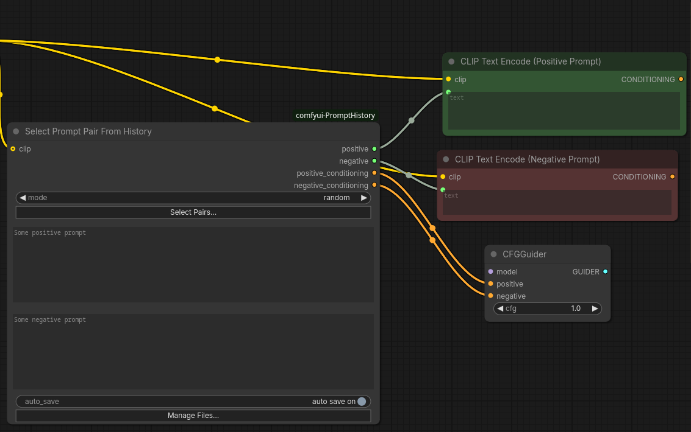
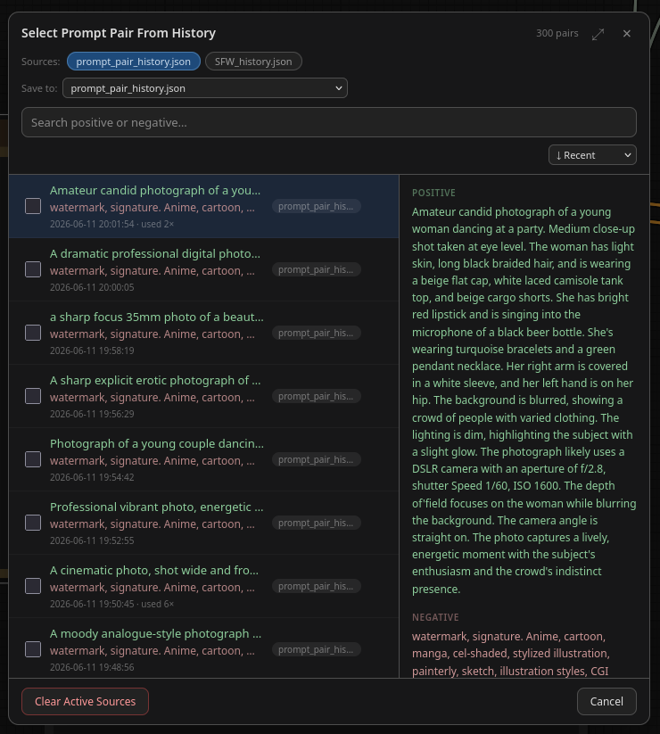

# comfyui-PromptHistory

Never lose a good prompt again. This extension adds two **Select Prompt From History** nodes that saves every prompt you use to plain JSON files — then lets you search, reuse, randomize, cycle, and batch-queue them straight from the node.

## Features

- **Persistent history** — prompts are saved to JSON files and survive restarts
- **Multiple history files** — manage separate collections (e.g. per-project or per-style)
- **Text search** — real-time search with case-sensitive, whole-word, and regex modes
- **Three operating modes** — edit a prompt manually, pick one randomly, or cycle sequentially
- **Deduplication** — identical prompts are merged; reusing one bumps its hit counter so favorites surface
- **Batch queue** — tick several prompts (click, Shift-click a range, or drag) and queue them as separate runs in one click
- **Repeat a batch** — the last few batches are remembered, so you can queue the same prompts again after changing seed, sampler or anything else
- **Safe deletes** — removing a prompt can be undone for a few seconds
- **Optional CLIP encoding** — connect a CLIP model and the node outputs conditioning directly, replacing a CLIP Text Encode node

 

## Installation

### ComfyUI Manager (recommended)

Search for **Prompt History** in the ComfyUI Manager custom node browser and install.

### Manual

```bash
cd ComfyUI/custom_nodes
git clone https://github.com/dawncreatescode/comfyui-PromptHistory
```

Restart ComfyUI. No extra Python packages are required.

## Quick start

1. Add the node: **Add Node → Prompt Tools → Select 'Prompt From History' or 'Prompt Pair From History'**
2. Wire it in one of two ways:

   **A — Drop-in replacement for CLIP Text Encode** (simplest):

   ```
   [Checkpoint Loader] ──clip──→ [Select Prompt (Pair) From History] ──conditioning──→ [KSampler positive/negative]
   ```

   **B — Text source for your existing setup:** leave `clip` unconnected and feed the `text` output into your CLIP Text Encode node (right-click it → convert its text widget to an input).

3. Type a prompt in the `text` widget and run the workflow. With `auto_save` on (the default), it's now in your history.
4. Next session, click **Select Prompts…** on the node, type a few words in the search box, and click the prompt to load it. Done.

## The three modes
| Mode | What happens each run |
|---|---|
| `edit` | Uses whatever is in the `text` widget — normal prompting; new prompts get saved to history |
| `random` | Picks a random prompt from your active history files — great for revisiting old ideas overnight |
| `sequential` | Steps to the next prompt in order — walk through an entire collection run by run |

For `random` and `sequential`, the files that are drawn from can be toggled in the history panel (see below).

## The history panel

Click **Select Prompts…** on the node to open it.

### Finding a prompt

- **Search** filters as you type. Several words must all match; put a phrase in `"quotes"` to match it exactly. Toggles add case-sensitive, whole-word, and regex matching.
- **Search scope** (pair node only) — a dropdown next to the toggles chooses whether the query matches the positive prompt (default), the negative prompt, or both.
- **Source chips** switch individual history files on and off. The same choice decides which files `random` and `sequential` draw from.
- **Save to** picks the file that receives new prompts.
- Hover a row (or use the arrow keys) to read the full prompt in the preview on the right, with a **Copy** button.
- The list loads 300 entries at a time and fetches more as you scroll; the counter shows how many match in total.
- Sort order, search toggles and panel size are remembered in your browser.

### Loading one prompt

Click a row. The prompt is copied into the node's `text` widget and the panel closes.

### Queueing several prompts

Tick the prompts you want, then press **Queue N**. Each ticked prompt becomes its own workflow run, in the order shown by the numbers in the tick boxes.

- **Tick** by clicking the box at the left edge of a row. The whole left edge is the target, not just the box.
- **Shift-click** ticks everything between the last ticked row and the one you click.
- **Drag** down the left edge to tick (or untick) a run of rows. **Ctrl-drag** does the same anywhere on the rows, and once something is ticked a plain drag over the prompts works too.
- **Ctrl-click** ticks a single row without loading it.
- **Select all** ticks every row currently shown — combine it with a search to queue everything that matches.
- **Once anything is ticked, clicking anywhere on a row ticks it** instead of loading it, so a near miss no longer closes the panel. Double-click (or Enter) still loads a prompt.
- **Show selected** lists only the ticked prompts, in queue order. Ticks survive searching and closing the panel.
- **▶** on a row queues just that prompt right away, without ticking it or changing what is in the node.

The node's own text and mode are put back after queueing. If ComfyUI rejects a run (for example because an input is missing), queueing stops, the panel stays open, and the prompts that were not queued stay ticked.

### Repeating a batch

**Recent ▾** lists the last 10 batches you queued. Click one to tick its prompts again, or press **Queue again** to run it immediately. The prompts are queued with the workflow's *current* settings, so this is the quick way to rerun a set with a different seed or sampler. The same list is in the node's right-click menu under **Repeat queue batch**.

Recent batches are stored in your browser, not in the history files.

### Deleting

- **✕** on a row removes that prompt. An **Undo** bar stays for a few seconds.
- **Delete N…** removes all ticked prompts after a confirmation, with the same Undo.
- Wiping a whole file is under **Manage Files… → Clear…**.

### Keyboard

| Key | Action |
|---|---|
| ↑ / ↓ | Move the highlight (also from the search box) |
| Shift + ↑ / ↓ | Tick rows as you move |
| Space | Tick the highlighted row |
| Enter | Load the highlighted prompt (the top result if none is highlighted) |
| Ctrl + Enter | Queue the ticked prompts, or the highlighted one if nothing is ticked |
| Ctrl + A | Tick all rows shown |
| Esc | Close |

After using the arrow keys, just start typing to continue searching.

### Managing files

**Manage Files…** on the node adds, removes, or discovers history files, and can clear a file.

## Seeing what random and sequential used

In `random` and `sequential` mode a read-only box on the node shows the prompt the last run picked. Your own text in the `text` widget is left untouched, so switching back to `edit` brings back the prompt you were working on. To keep working from the picked prompt instead, press **Edit this prompt**: it copies it into the `text` widget and switches the node to `edit`.

## Files and paths — which field does what

The node keeps three path-related fields. They are hidden on the node and managed from the panel and **Manage Files…**:

| Field | Purpose |
|---|---|
| `history_paths` | Every history file the node knows about — one path per line |
| `save_to_path` | The single file that receives newly saved prompts |
| `active_paths` | Which files `random`/`sequential` draw from; set with the panel's source chips |

Paths can be absolute or relative to the ComfyUI root. The default file is created at:

```
ComfyUI/custom_nodes/comfyui-PromptHistory/history/prompt_history.json
```

## History file format

History is a plain JSON array — trivial to back up, sync between machines, hand-edit, or share:

```json
[
  {
    "key": "abc123def456abcd",
    "text": "a futuristic city at dusk, neon reflections, cinematic",
    "ts": "2026-03-12 14:05:00",
    "hits": 7
  }
]
```

`hits` counts how often a prompt has been reused. Duplicate prompts are never stored twice — saving an existing prompt just increments its counter. `max_entries` (default 500 000) caps file size.

> **Note:** prompts are stored as plain text on disk. Keep that in mind before committing history files to a public repo or sharing them.

## Node reference

**Category:** Prompt Tools

### Inputs

| Name | Type | Description |
|---|---|---|
| `mode` | dropdown | `edit` · `random` · `sequential` (see [modes](#the-three-modes)) |
| `text` | string | Prompt text (active in `edit` mode) |
| `clip` | CLIP | Optional — enables the conditioning output |
| `auto_save` | boolean | Save used prompts automatically (default: on) |
| `history_paths` | string | Newline-separated list of history file paths |
| `save_to_path` | string | File that receives new prompts |
| `active_paths` | JSON | Managed by the panel — files used for `random`/`sequential` |
| `max_entries` | integer | Max prompts per file (default: 500 000) |

### Outputs

| Name | Type | Description |
|---|---|---|
| `text` | STRING | Selected or edited prompt |
| `conditioning` | CONDITIONING | CLIP-encoded output (requires `clip` input) |

## FAQ

**Where is my history stored?** In the JSON file(s) you configure — by default inside this node's `history/` folder. They're just files: copy them to back up or move machines.

**Can I share a prompt library with someone?** Yes — send them the JSON file; they add its path via **Manage Files…**.

**I saved the same prompt twice — where did it go?** Duplicates are merged automatically; the existing entry's `hits` counter went up instead.

**Does updating ComfyUI or this node delete my history?** No — but since the default location is inside the node folder, prefer a path outside `custom_nodes/` if you reinstall from scratch often.

## License

MIT — see [LICENSE](LICENSE).
